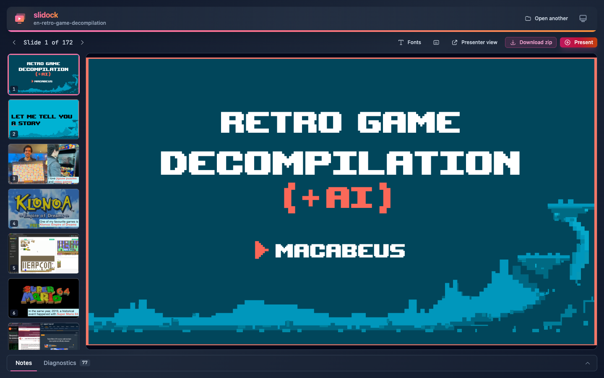

# slidock

slidock turns a presentation (PowerPoint `.pptx`, Keynote `.key`, OpenDocument `.odp`) into a standalone HTML deck:
one `index.html` with its media, which presents with the slides' transitions, builds and fonts from any static host
or straight from the disk. It runs entirely in your browser, or as a command-line tool.



**Try it:** [macabeus.github.io/slidock](https://macabeus.github.io/slidock/). Drop a deck on the page: it is compiled
on your machine and never uploaded.

## Install

- **Prebuilt CLI:** download `slidock-vX.Y.Z-<target>.tar.gz` (Windows: `.zip`) from
  [GitHub Releases](https://github.com/macabeus/slidock/releases), where `<target>` is `aarch64-apple-darwin`,
  `x86_64-apple-darwin`, `x86_64-unknown-linux-gnu`, `aarch64-unknown-linux-gnu` or `x86_64-pc-windows-msvc`. Check
  it with `sha256sum -c slidock-vX.Y.Z-<target>.tar.gz.sha256` (macOS: `shasum -a 256 -c …`), extract it and put
  `slidock` on your `PATH`. The Linux builds need glibc 2.35 or later. The macOS binaries are not notarized: if
  Gatekeeper blocks one, run `xattr -d com.apple.quarantine slidock`.
- **From source** (Rust only): `cargo install --locked --git https://github.com/macabeus/slidock slidock-cli`.
  `--locked` keeps the exact dependency versions slidock is tested with.

## Quick start

In the browser: open the [web app](https://macabeus.github.io/slidock/), drop a `.pptx`, `.key` or `.odp` (or a
Keynote package folder), view it, present it (P opens the presenter view), and download the zip.

On the command line:

```sh
slidock deck.pptx                  # writes deck.zip in the working folder: the zip the web app downloads
slidock deck.key -o site/          # the same files, as a folder
slidock deck.odp --offline         # no network request at all
slidock compile --help             # every option
```

`slidock <file>` is short for `slidock compile <file>`; without `-o`, the deck is written as `<name>.zip` in the
working folder.

Unzip the deck and open `index.html`: it presents with PowerPoint's keys (Space or → next, ← previous, B/W blank, a
number then Enter to jump, P presenter view, ? help, Escape to stop). The page also carries the slides' text below
the stage, for readers and search engines; `--title`, `--description` and `--site-url` set its metadata, and
`--no-presenter`, `--no-notes`, `--notes-on-page` and `--no-text-view` choose what ships.

Fonts come first from the presentation itself. By default the CLI then **downloads the fonts still missing from
Google Fonts** (open-licence families only) and caches them in your user cache folder (`SLIDOCK_CACHE_DIR` chooses
another). `--system-fonts` also takes fonts installed on your computer, and `--fonts <dir>` a folder of font files. A
font found nowhere is replaced by a bundled metric-compatible substitute.

Diagnostics go to stderr: errors, declines, losses and warnings are listed with a one-line summary; `-v` lists
everything, `-q` errors only. Every code is described in [docs/diagnostics.md](docs/diagnostics.md). The exit code is
0 when the deck was written (warnings and losses allowed), 1 when the compile reported errors (a slide that could not
be converted is left out; a presentation that fails as a whole, or an output that cannot be written, leaves no deck),
and 2 for a refused input or bad usage. `--timeout <secs>` stops a compile that runs too long.
`--emit ir,documents,report` writes what the compiler sees instead of a deck: the IR, a standalone HTML document per
slide and layout, and the compile report.

## What it reads

- **Formats:** PowerPoint (`.pptx`), Keynote (`.key`, a file or a package folder) and OpenDocument presentations
  (`.odp`).
- **Slides:** masters, layouts and themes; backgrounds; hidden slides; speaker notes.
- **Elements:** shapes (preset and custom geometry, connectors, line ends), text (runs, bullets and numbering,
  autofit, tabs, fields, links), pictures (crops, masks and clips, SVG, animated GIF, TIFF and BMP transcoded, HEIC
  in the web app where the browser decodes it), video and audio, tables, groups.
- **Paint:** solid fills, linear and radial gradients, picture fills, solid and dashed strokes, outer shadows,
  opacity, rotation and flips.
- **Motion:** slide transitions and build animations (entrances, emphases, exits, motion paths), mapped to one common
  effect vocabulary and played by the deck's own player, Keynote's Magic Move included.
- **Fonts:** faces embedded in the file, Google Fonts for open-licence families, fonts installed on your computer
  (opt-in), font files you add, and bundled metric-compatible substitutes (Liberation, DejaVu Sans, Carlito,
  Caladea). Faces ship subset, as WOFF2; a face whose licence forbids embedding never ships.

Known limits: charts, SmartArt, OLE objects and equations show as the fallback picture the file carries, else a marker;
pattern and tiled fills, glow, reflection, soft edges, 3D effects, shear and vertical text are approximated or left
out; an effect with no equivalent in the vocabulary plays a declared fallback. Every loss is reported with its
diagnostic. [docs/decisions.md](docs/decisions.md) lists the standing decisions about the output.

## Privacy

Decks are compiled locally, in a worker in the browser or by the CLI; nothing is uploaded. By default both fetch
Google Fonts for the open-licence families a deck names, never sending the deck's text (the CLI caches the files in
your user cache folder). The web app's Google Fonts switch turns that off; the CLI's `--offline` makes no network
request at all, and `--no-google` takes no Google face, not even a cached one. A downloaded deck makes no request of
its own.

## Documentation

- [docs/format.md](docs/format.md): the deck format (the zip, `index.html`, the deck JSON, the timeline, the IR).
- [docs/player-api.md](docs/player-api.md): the player every deck embeds, for hosting decks in your own page.
- [docs/diagnostics.md](docs/diagnostics.md): every diagnostic code.
- [docs/decisions.md](docs/decisions.md): standing decisions and limitations.
- [CONTRIBUTING.md](CONTRIBUTING.md): building, testing and sending changes.
- [SECURITY.md](SECURITY.md): the threat model, how exported decks are kept safe, the resource limits, running
  slidock as a service, and reporting a vulnerability.

## Requirements

To build from source:

- Rust through [rustup](https://rustup.rs): `rust-toolchain.toml` pins 1.99.1 with the `wasm32-unknown-unknown`
  target, which rustup installs on the first cargo command.
- Node 22.18 or later, and pnpm 9.14.4: `corepack enable` provides the version `package.json` pins.
- wasm-pack 0.15.0: `cargo install wasm-pack --version 0.15.0 --locked`. It builds with the wasm-bindgen 0.2.129
  that `Cargo.lock` pins; a `wasm-bindgen` CLI you install yourself must be that version too.
- For the browser tests: `pnpm exec playwright install chromium webkit firefox`.
- The tests also need `git`, `unzip` and `node` on `PATH`.

## Development

```sh
pnpm install
pnpm wasm:build           # the player, then crates/slidock-wasm built into packages/wasm/pkg
pnpm dev                  # the web app on http://localhost:5173/
pnpm build                # every package and app
```

Run `pnpm wasm:build` before `pnpm test`, `pnpm typecheck` or `pnpm -r build`: the web app and its tests import the
built wasm package, and those commands say so when it is missing. The CLI embeds the player's scripts from
`crates/slidock-bundle/player/`, a committed copy of the player's build: `pnpm player:build` updates it (commit it
with any player change) and `pnpm player:check` checks it is fresh, as CI does.

The checks CI runs:

```sh
cargo fmt --all --check
cargo clippy --workspace --all-targets -- -D warnings
cargo test --workspace
cargo build --target wasm32-unknown-unknown -p slidock-wasm -p slidock-bench-metrics -p slidock-bench-schema
cargo deny check
pnpm format:check && pnpm lint && pnpm typecheck && pnpm test && pnpm -r build
```

More suites: `pnpm --filter @slidock/web e2e:smoke` (the app and its zip in Chromium, Firefox and WebKit),
`pnpm --filter @slidock/player e2e` (every effect of the player) and `cargo xtask fuzz-smoke --seconds 10` (the fuzz
targets, on nightly with cargo-fuzz; see `fuzz/README.md`).

### Maintainer-only: the private corpus

Some checks run on a private corpus of real decks, which never enters the repository. It lives under
`$SLIDOCK_PRIVATE` (default `~/.slidock`), and the checks skip, saying so, when it is absent. Contributors do not need
them.

- **Goldens:** slidock's own outputs on the corpus, pinned by SHA-256 in `tests/golden/manifest.json`.
  `cargo xtask golden --check` (after `pnpm wasm:build`) verifies them and compiles them again; each crate's suite
  runs with `cargo test -p <crate> --features golden`.
- **Corpus end to end:** `pnpm --filter @slidock/web e2e` runs the app suite on every corpus deck
  (`apps/web/e2e/README.md`).
- **Bench:** `slidock-bench` scores every corpus slide against the authoring app's own PDF export in a pinned
  Chromium, and checks the player, the fonts, the motion, the downloaded zip, determinism and budgets.
  [bench/README.md](bench/README.md) describes it, and how to run it on a corpus of your own.

## Repository layout

- `crates/`: the compiler (Rust; it builds natively and to WebAssembly and writes the same bytes on both), the
  `slidock` CLI and the fidelity bench.
- `packages/player`: the framework-free player every deck embeds; `packages/wasm`: the compiler's WebAssembly build
  and its worker protocol; `packages/types`: TypeScript types generated from Rust; `packages/ui`: the apps' tokens
  and primitives.
- `apps/web`: the web app (React, Tailwind, GitHub Pages); `apps/bench-web`: the bench results UI.
- `probes/`: decks of our own, each exercising some features; `bench/`, `fuzz/`, `xtask/`: the bench's public
  configuration, the fuzz targets and the repository tasks.

## License

MIT, see [LICENSE](LICENSE). `slidock-presets` and `xtask` also contain files under the Mozilla Public License 2.0
derived from LibreOffice. [NOTICE](NOTICE) lists every third-party work slidock includes (Heroicons, fdlibm, ECMA-376's
preset shapes, the keynote-parser schema, LibreOffice's preset tables, the bundled fonts), with full licence texts in
[LICENSES/](LICENSES). [THIRD-PARTY-NOTICES.txt](THIRD-PARTY-NOTICES.txt), which `slidock licenses` prints and the web
app links, lists every crate and package the binaries are built from, with their licences.

Keynote is a trademark of Apple Inc. and PowerPoint of Microsoft Corporation; slidock is not affiliated with either.
